# Phainon niri rice

A desktop for [niri](https://github.com/YaLTeR/niri) that wears one Honkai: Star Rail character in three forms. It sits on top of [DankMaterialShell](https://github.com/AvengeMedia/DankMaterialShell) (DMS), so you keep everything DMS already does well (settings, plugins, keybinds, lock screen) and only the look changes.

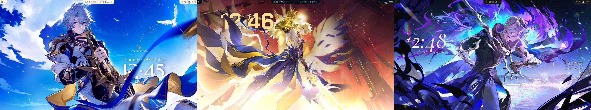

Pick a form and the whole desktop follows: colours, shapes, fonts, wallpaper, GTK apps, even the folder icons. Apps like Zed, Vesktop and Qt apps can follow too (see [SETUP.md](SETUP.md)).

| Form | Mood |
|---|---|
| **Phainon** | Light. Paper, lapis blue and a bit of sun gold. Soft round corners. |
| **Khaslana** | Navy-black and gold, sharp cut corners, a little glitchy on purpose. |
| **Flame Reaver** | Charcoal, bone and one violet. Quiet, lowercase, text-heavy, almost no animation; panels hang like his torn cloak. |

## What it looks like

### Phainon

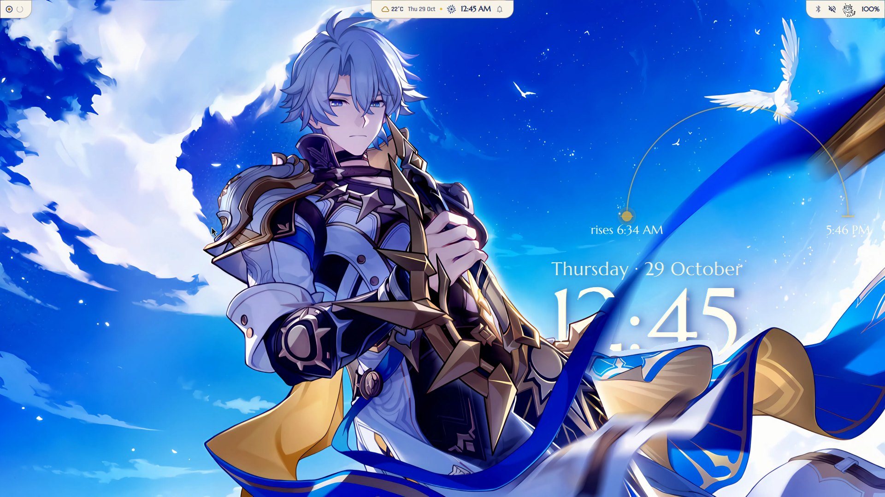

| Dashboard | Control panel |
|---|---|
| 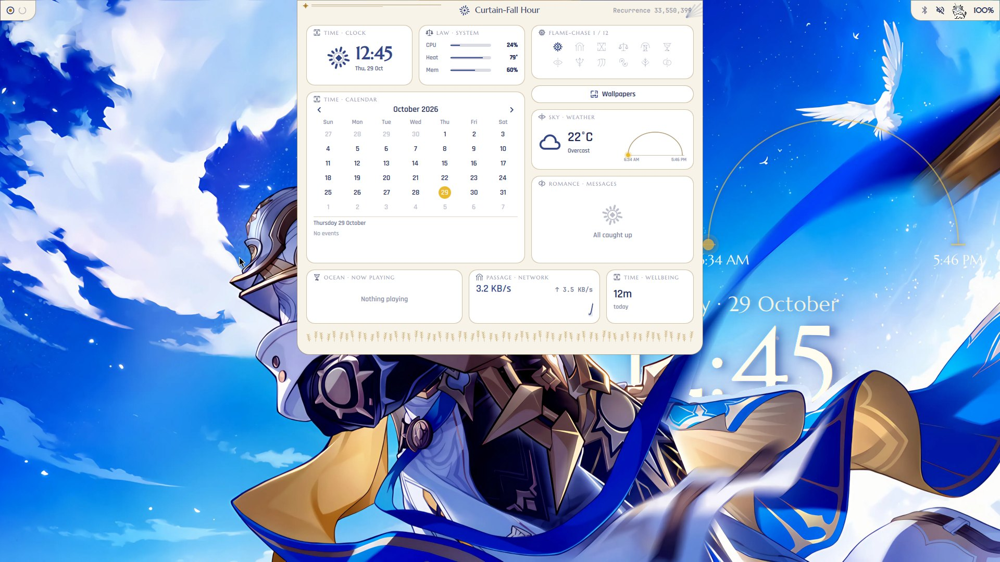 | 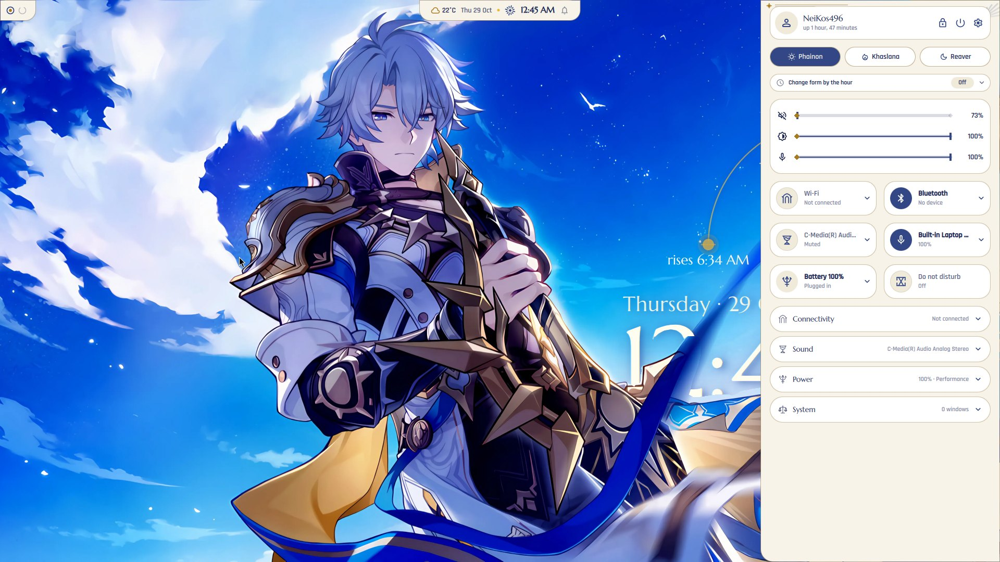 |

| Launcher | Power menu |
|---|---|
| 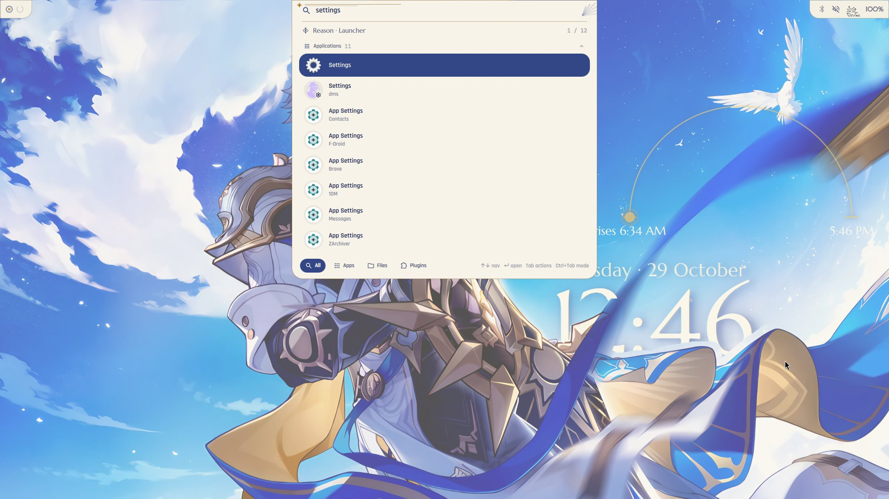 | 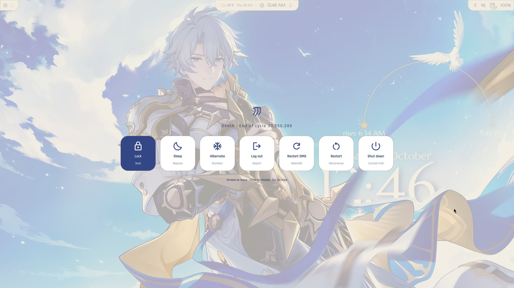 |

### Khaslana

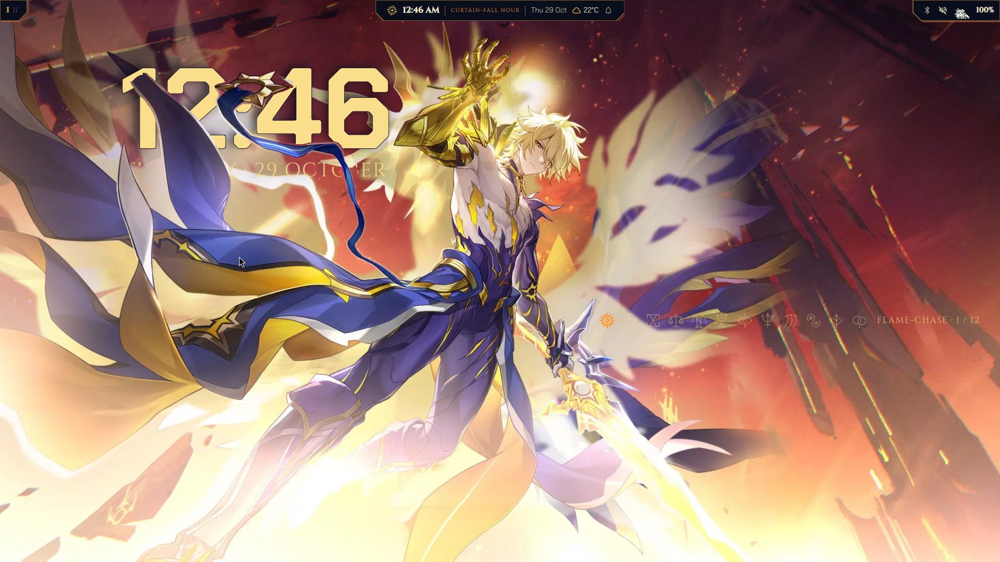

| Dashboard | Control panel |
|---|---|
| 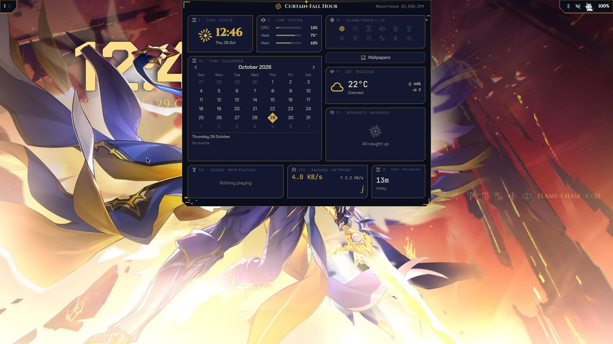 | 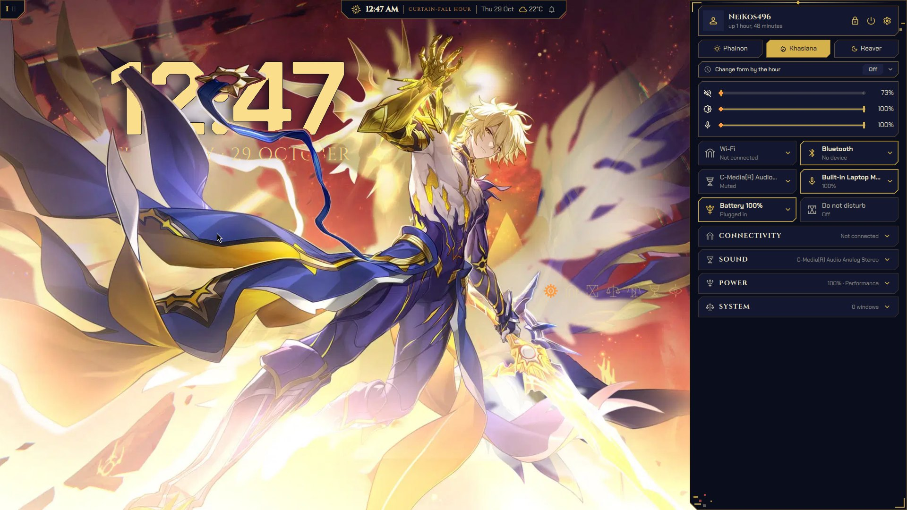 |

| Launcher | Power menu |
|---|---|
| 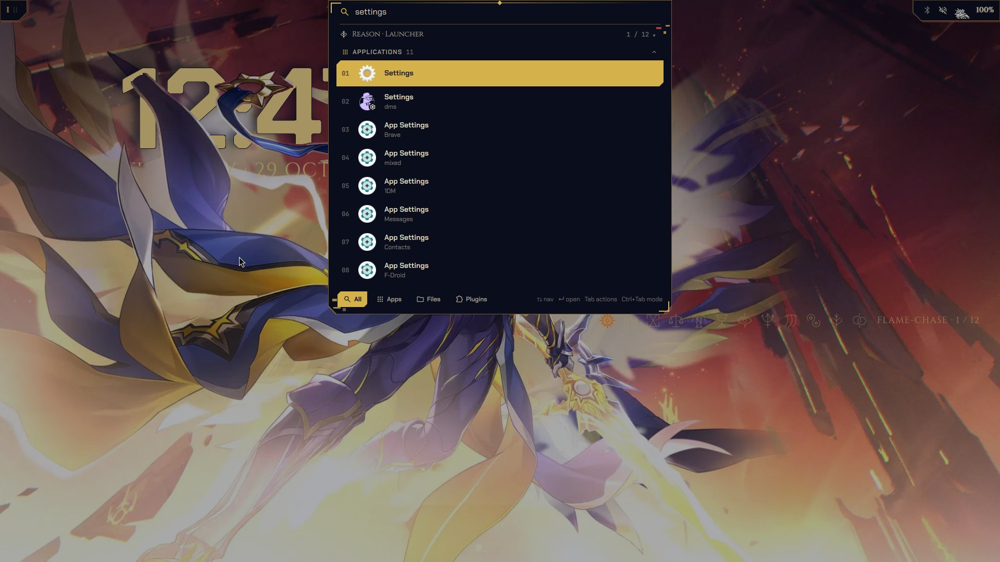 | 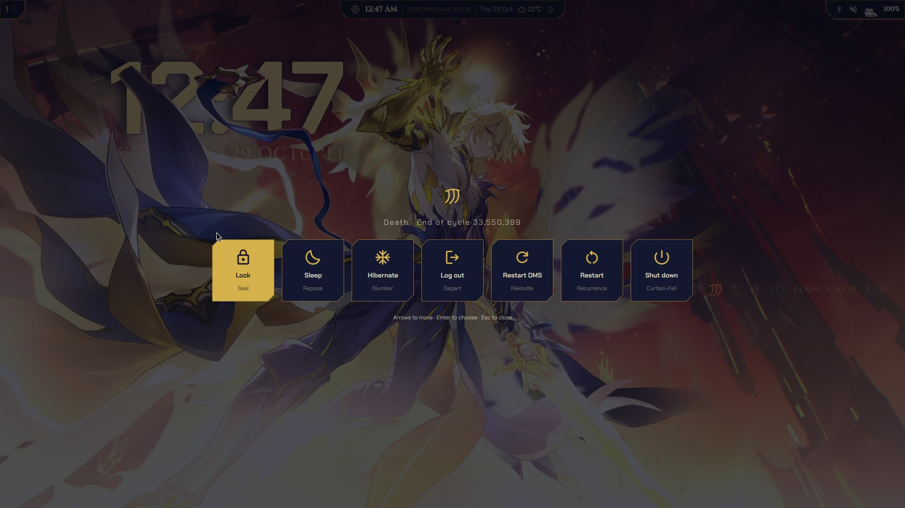 |

### Flame Reaver

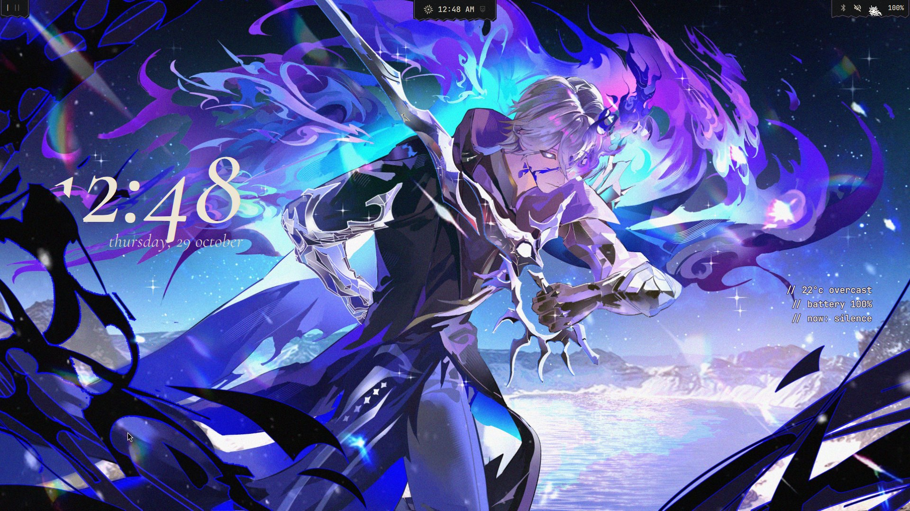

| Dashboard | Control panel |
|---|---|
| 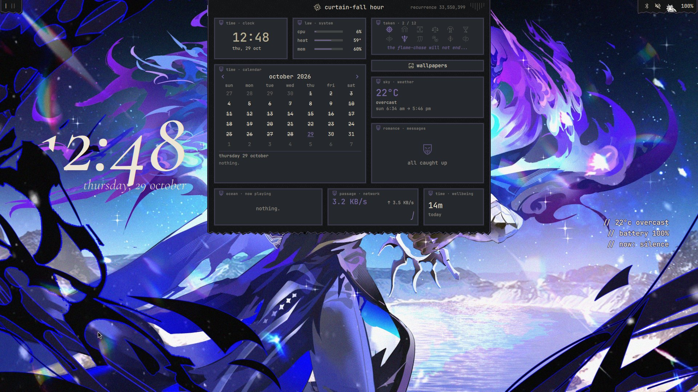 | 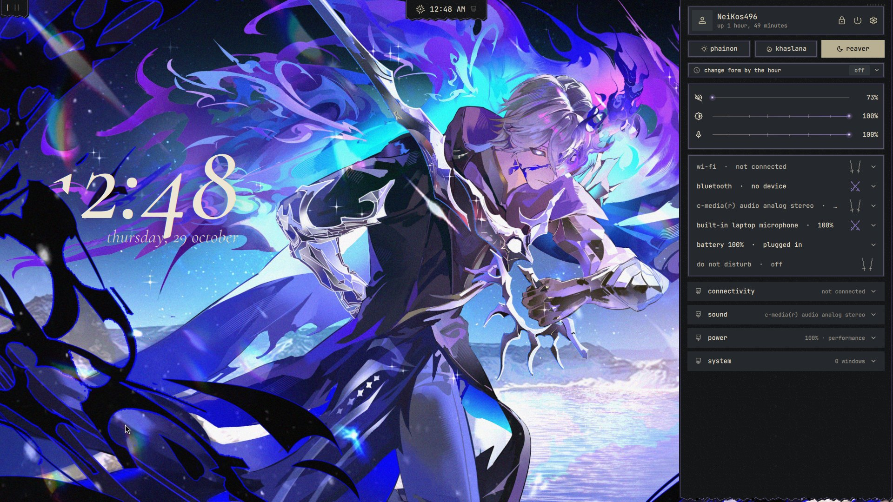 |

| Launcher | Power menu |
|---|---|
| 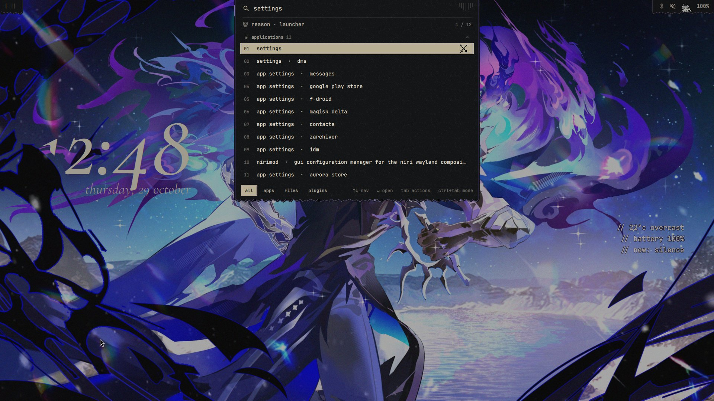 | 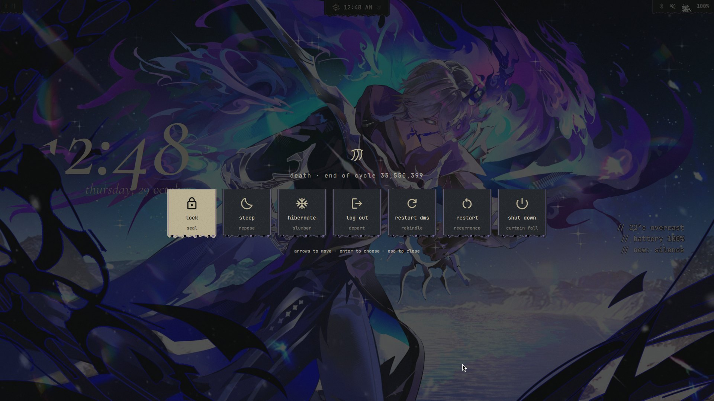 |

## What you get

- **A clock set into the wallpaper.** A large clock stands behind each form's character: whatever is near in the picture (him, his cape, the tendrils) passes in front of it. Each form adds one quiet piece in the same layer: Phainon a sun path across the sky, Khaslana the twelve Flame-Chase embers, the Flame Reaver a three-line readout of weather, battery and what's playing.
- **No bar.** A dynamic island at the top centre (clock, date, weather, what's playing, notifications), with a small workspace tab on the left and a status tab on the right.
- **Island pop-ups.** Volume, brightness, caps lock, mic mute, touchpad and workspace changes show for a moment in the island instead of DMS's own pop-ups. Each one follows its on/off switch in DMS Settings. With Do not disturb set to end at a time, the island says until when ("Muted until 18:00").
- **Dashboard** that drops out of the island: clock, system load, calendar with your events, flame-chase, weather, notifications, music, network and screen time on one page. Each card opens its own full view. The clock opens a full time view: the date in full, a world clock on a small globe (add cities by searching), a timer and a stopwatch. The wallpaper picker sits under the Flame-Chase card.
- **Notifications live in the dashboard.** The island bell and the notifications keybind open the dashboard's messages view. A notification that arrives while a panel is open shows along that panel's top edge.
- **Control panel** from the right corner, kept short: volume, brightness and mic, Wi-Fi, Bluetooth, sound output and input, battery and Do not disturb. Everything else sits in four sections you open when you need them: Connectivity (Wi-Fi networks, Bluetooth devices, and a search for new ones to pair), Sound, Power and System (night mode, running apps, plugins, tray, clipboard, "Return to stock DMS").
- **Launcher, clipboard history, notepad and system monitor** grow out of the island, in the same style, on the same keybinds DMS already uses. Copied pictures get a large preview in the clipboard history.
- **Dock** at the bottom edge with the current workspace's windows. In Phainon the icons grow a little under the pointer; each form marks the focused app its own way.
- **Forms by the hour, or by the sun:** the form can change by itself at set times, or with Phainon at sunrise and Khaslana at sunset.
- **Power menu** with lock, sleep, log out, restart DMS ("Rekindle"), restart and shut down. Hibernate ("Slumber") shows up too when your swap and kernel settings allow it.
- **Lock screen.** In Phainon the clock moves to the calmest part of the wallpaper.
- **Lock screen video.** After 15 seconds on the lock screen with no input, a muted video plays full screen while you are plugged in or above 50 % battery. Any key or mouse move brings the password field back.
- **Window animation:** windows open and close with a short black-and-red eclipse, the "Black Tide" from Phainon's technique. On the Power Saver profile they just fade.
- **Opening and closing cinematics** play at the first start after boot and before a restart or shut down.
- **A little Phainon chimera** in the corner that sleeps when your CPU is idle and runs faster the harder it works.
- **Scroll on the island** to move between workspaces.
- **Small nods to the story**, like the cycle counter that starts at 33,550,336 and goes up by one each boot.
- **A safety net.** If the shell ever fails to start, it puts stock DMS back by itself.

## Before you start

**This isn't a standalone shell.** To use it, niri has to be your compositor and DankMaterialShell has to be the shell you actually run every day. The rice swaps out stock DMS's interface for its own, while DMS keeps running underneath doing the real work (settings, plugins, notifications, network, and so on). Think of it as a theme, just one that changes the whole look instead of only the colours. No niri or no DMS means nothing for it to sit on.

You need:

- niri
- DankMaterialShell **2.0**, running as the usual `dms` systemd user service
- `rsync`, `python3` and `git`

**Fair warning:** I built this for my own laptop (Fedora, niri, one 1080p screen) and that is the only machine it has been used on. It works for me; it might not work the same on yours. Different distro, screen size, DMS version or hardware can all trip it up, so treat it as something to try and tinker with, not a polished release.

This is built on the DMS 2.0 interface. On another DMS version it may not load. If that happens the safety net simply drops you back to stock DMS.

## Install

```sh
git clone https://github.com/MSpider3/Phainon_niri_rice.git
cd Phainon_niri_rice
sh install.sh
```

That copies the fonts, the three wallpapers (into `~/Pictures/Phainon`), the theme and a tiny form-switch plugin, then restarts DMS with the new look. Your bar will blink for a few seconds.

Want the matching icons and folders too? Run it like this instead (downloads about 185 MB of [Gruvbox Plus](https://github.com/SylEleuth/gruvbox-plus-icon-pack) icons):

```sh
sh install.sh --icons
```

## Using it

Switch form from the buttons at the top of the control panel, or from a terminal:

```sh
dms ipc call form set phainon
dms ipc call form set khaslana
dms ipc call form set reaver
```

Your keybinds don't change. Whatever opens the DMS launcher, clipboard, process list or power menu on your setup now opens the themed one.

## Going back

```sh
sh coreflame.sh off
```

Stock DMS comes back with the theme, wallpaper cycling and icons you had before. There is also a "Return to stock DMS" button in the control panel's System section (double-click it).

## Making it yours

- **Wallpapers:** replace the three pictures in `~/Pictures/Phainon` (keep the file names), or change the names in `overlay/Common/Form.qml`. The desktop clock's depth only fits the shipped pictures; with your own, the clock shows without the character in front.
- **Colours:** everything comes from `dms-config/theme/coreflame/theme.json`.
- **The interface:** all custom pieces live in `overlay/`. Edit, run `sh build.sh`, and the shell picks it up.
- **Try changes safely:** `sh dev/run-nested.sh ~/.cache/cfn khaslana` opens a sandboxed copy in its own window, so you can break things without touching your real session.

A heads-up: while a form is active, DMS wallpaper cycling is switched off so the form's wallpaper stays put. It comes back when you leave.

## Credits

- [DankMaterialShell](https://github.com/AvengeMedia/DankMaterialShell) by Avenge Media, MIT. A copy of its 2.0 interface is in `vendor/` and this rice is a layer on top of it.
- [Gruvbox Plus icon pack](https://github.com/SylEleuth/gruvbox-plus-icon-pack) by SylEleuth, GPL-3.0. The folder artwork in `icons/` comes from it and stays under that licence.
- The desktop clock's depth masks were made with Depth Anything V2 Small (Apache-2.0) and anime-seg (Apache-2.0); no model ships with the rice. The world clock's land map comes from Natural Earth (public domain).
- Fonts in `fonts/`: Marcellus, Cinzel, Chakra Petch and Cormorant Garamond, all under the SIL Open Font License.
- The chimera sprite is from a fan-made Chimera Phainon desktop pet. The wallpapers are fan art. I didn't make either and all credit goes to their artists. If one of them is yours and you'd like credit or removal, open an issue.
- Phainon and Honkai: Star Rail belong to HoYoverse. This is a fan project and is not affiliated with them.

Everything written for this project is under the [MIT licence](LICENSE).
